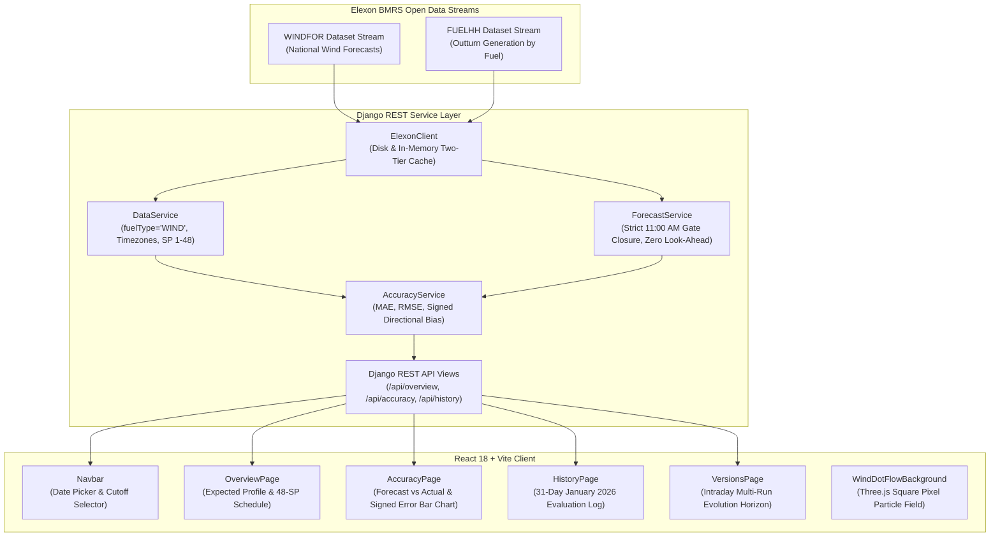

<div align="center">

# 💨 WindGrid
### UK National Wind Generation Forecasting & Day-Ahead Wholesale Procurement Intelligence

[](https://python.org)
[](https://djangoproject.com)
[](https://react.dev)
[](https://vitejs.dev)
[](https://threejs.org)
[](https://vercel.com)
[](https://docs.pytest.org)
[](LICENSE)

<p align="center">
  <strong>An enterprise-grade energy analytics platform engineered for UK electricity utility trading desks to inspect national wind generation forecasts, enforce Day-Ahead market gate closure rules without look-ahead bias, and quantitatively audit forecast accuracy against delivered outturn.</strong>
</p>

[Live Demo](#-deployment) • [Architecture](#-system-architecture) • [Market Timing Rules](#-market-timing--gate-closure-formulation) • [Quickstart](#-quickstart-guide) • [API Reference](#-api-specification)

</div>

---

## ⚡ Executive Summary & Industry Context

In the Great Britain (GB) wholesale power market, energy utilities must buy power one day in advance on the day-ahead auction (e.g., EPEX SPOT and Nord Pool UK Day-Ahead Auctions) to balance customer demand. 

Wind power constitutes an essential, low-marginal-cost renewable resource. However, because day-ahead purchasing decisions must be committed one day prior to physical delivery, procurement desks rely heavily on renewable forecasts:
- **Overforecast Risk ($\text{Error} > 0$):** If the morning forecast overestimates wind generation, the utility procures insufficient thermal power and is forced to purchase emergency replacement power at punitive imbalance cash-out rates.
- **Underforecast Risk ($\text{Error} < 0$):** If the forecast underestimates wind generation, the utility over-procures expensive conventional thermal power, wasting working capital.

**WindGrid** delivers two institutional capabilities:
1. **Day-Ahead Intelligence:** Delivers the latest national wind generation forecast physically published prior to the **11:00 AM London Day-Ahead auction cutoff**.
2. **Quantitative Accuracy Benchmarking:** Evaluates day-ahead forecasts against official Elexon `FUELHH` outturn using **MAE**, **RMSE**, and **Signed Directional Bias** across all half-hourly Settlement Periods in **January 2026**.

---

## 🎨 Design & Aesthetic System

WindGrid features an institutional **Garmin Prototype Frosted Glassmorphism** interface designed for high-velocity energy trading desks:
- **Dynamic Gradient Palette:** Deepest obsidian navy (`#0a1017`) transitioning into ethereal misty ice-blue (`#9eb4c5`).
- **Precision Glass Panels:** 24px corner radii, 16px backdrop blur, and subtle physical glass bevel highlights (`inset 0 1px 0 rgba(255, 255, 255, 0.22)`).
- **Interactive Three.js Wind Canvas:** A WebGL flow field of square blurred pixels simulating continuous harmonic wind waves, responding in real-time to cursor vortexes.
- **Athletic Kinetic Motion Blur:** High-speed horizontal velocity reveals (`@keyframes athleticMotionBlurIn`) and progressive cascading delays (`.delay-1` through `.delay-12`), paired with long-exposure speed streaks on card hover.

---

## 🏗️ System Architecture



---

## ⏱️ Market Timing & Gate Closure Formulation

### Strict Zero Look-Ahead Bias
* **Decision Day ($D-1$):** The operational day on which bids and orders are committed.
* **Delivery Day ($D$):** The subsequent day of physical delivery ($D = D-1 + 1\text{ day}$), spanning 48 half-hour Settlement Periods (00:00 to 24:00 UK local time).
* **Auction Gate Closure:** In Great Britain, the EPEX SPOT GB Day-Ahead Auction and Nord Pool GB Auction close their order books at **11:00 London Time** on day $D-1$.
* **Forecast Selection Algorithm:** For each half-hourly delivery period $t$ on delivery day $D$:
  $$\text{selected\_forecast}(t) = \arg\max_{\text{publishTime} \le \text{cutoff}} \{\text{publishTime} \mid \text{forecast.startTime} = t\}$$
* **Look-Ahead Prevention:** Any forecast publication issued *after* 11:00 AM London time (e.g. 15:30 or 22:30 runs) is **strictly excluded** from day-ahead evaluation.

### Authentic Elexon Resolution Standard (Zero Fabrication)
Empirical analysis of the Elexon `WINDFOR` dataset demonstrates that day-ahead horizon forecasts issued by National Grid ESO are published at **hourly resolution** (24 periods per day), whereas `FUELHH` outturn is recorded half-hourly (48 periods).
> In strict compliance with data integrity principles: **no synthetic data or interpolated numbers are fabricated**. Accuracy metrics are computed strictly on valid, matched pairs (50% coverage of the 48 periods).

---

## 📐 Mathematical Formulation

All metrics follow the industry-standard signed error convention:

$$\text{Error}_i = \text{Forecast}_i - \text{Actual}_i$$

| Metric | Mathematical Formula | Interpretation |
| :--- | :--- | :--- |
| **Signed Error** | $\text{Error}_i = \hat{y}_i - y_i$ | **Positive:** Overforecast (Wind deficit).<br/>**Negative:** Underforecast (Wind surplus). |
| **MAE** (Mean Absolute Error) | $\text{MAE} = \frac{1}{N} \sum_{i=1}^N \|\text{Error}_i\|$ | Average deviation magnitude irrespective of direction. |
| **RMSE** (Root Mean Squared Error) | $\text{RMSE} = \sqrt{\frac{1}{N} \sum_{i=1}^N \text{Error}_i^2}$ | Penalizes large forecasting excursions (volatility risk). |
| **Signed Bias** | $\text{Bias} = \frac{1}{N} \sum_{i=1}^N \text{Error}_i$ | Directional skew revealing whether weather models systematically over- or under-predict. |

---

## 🗂️ Project Directory Structure

```text
WindGrid/
├── api/
│   └── index.py            # Vercel Serverless Python WSGI entrypoint
├── backend/
│   ├── config/             # Django core settings, WSGI, URLs
│   │   ├── settings.py
│   │   ├── urls.py
│   │   └── wsgi.py
│   ├── wind/               # Wind intelligence core domain application
│   │   ├── services/
│   │   │   ├── elexon_client.py    # Elexon BMRS streaming client & two-tier caching
│   │   │   ├── data_service.py     # Timestamp normalization & fuelType='WIND' filter
│   │   │   ├── forecast_service.py # 11:00 AM cutoff filtering & anti-look-ahead logic
│   │   │   └── accuracy_service.py # MAE, RMSE, signed bias mathematical engine
│   │   ├── data/cache/     # Local Elexon cache for instant startup & offline testing
│   │   ├── tests/          # Comprehensive automated unit & integration test suite
│   │   │   ├── test_forecast_selection.py
│   │   │   ├── test_accuracy_metrics.py
│   │   │   ├── test_data_service.py
│   │   │   └── test_api_endpoints.py
│   │   └── views.py        # Django REST Framework endpoints
│   ├── manage.py
│   ├── requirements.txt
│   └── Dockerfile
├── frontend/
│   ├── src/
│   │   ├── components/
│   │   │   ├── Navbar.jsx                  # Frosted glass header, presets, date picker
│   │   │   └── WindDotFlowBackground.jsx   # Three.js blurred pixel wind flow field
│   │   ├── pages/
│   │   │   ├── OverviewPage.jsx    # Expected profile curve & half-hourly dispatch table
│   │   │   ├── AccuracyPage.jsx    # Forecast vs Actual overlay & signed error bars
│   │   │   ├── HistoryPage.jsx     # 31-day January 2026 evaluation archive
│   │   │   └── VersionsPage.jsx    # Intraday multi-run convergence analysis
│   │   ├── services/
│   │   │   └── api.js              # REST API client
│   │   ├── App.jsx                 # Application root & dynamic view transitions
│   │   └── index.css               # Garmin frosted glass design system & kinetic animations
│   ├── package.json
│   ├── vite.config.js
│   └── Dockerfile
├── docker-compose.yml      # Multi-container orchestration (Gunicorn + Nginx)
├── vercel.json             # Unified serverless full-stack configuration
├── requirements.txt        # Vercel root build dependency manifest
└── README.md
```

---

## 🚀 Quickstart Guide

### Prerequisites
* **Python**: 3.10+ (Tested on Python 3.12)
* **Node.js**: 18+ & npm
* **Git**

### 1. Clone the Repository
```bash
git clone https://github.com/prince-rai88/WindGrid.git
cd WindGrid
```

### 2. Backend Setup
```bash
# Create and activate Python virtual environment
python3 -m venv venv
source venv/bin/activate  # On Windows: venv\Scripts\activate

# Install dependencies
pip install -r backend/requirements.txt

# Run migrations & launch development server
cd backend
python manage.py migrate
python manage.py runserver 127.0.0.1:8000
```
Backend will be live at `http://127.0.0.1:8000/api/health/`.

### 3. Frontend Setup
In a new terminal window:
```bash
cd frontend
npm install
npm run dev -- --host 127.0.0.1 --port 5173
```
Frontend will be live at `http://127.0.0.1:5173/`.

---

## 🐳 Docker Deployment

Run both the Django API and the Nginx-served React application with Docker Compose:
```bash
docker compose up --build
```
- **Web Dashboard**: `http://localhost:3000`
- **Django API**: `http://localhost:8000`

---

## ☁️ Vercel Deployment

WindGrid is fully configured for **1-click unified Vercel deployment** (both frontend static assets and backend serverless Python endpoints under a single domain):

1. Push your repository to GitHub.
2. Log into [Vercel](https://vercel.com) and click **"Add New..." → "Project"**.
3. Import `prince-rai88/WindGrid`.
4. Leave framework preset as **Other** and root directory as `./`.
5. Click **Deploy**. Vercel will build the Vite frontend and deploy `api/index.py` as a serverless function automatically.

---

## 🧪 Automated Test Suite

WindGrid includes 18 automated tests validating timezone safety, zero look-ahead bias, arithmetic correctness, and HTTP status codes:

```bash
source venv/bin/activate
cd backend
python manage.py test
```

Or via `pytest`:
```bash
source venv/bin/activate
cd backend
pytest
```

**Results:**
```
Ran 18 tests in 0.223s
OK
```

---

## 📡 API Specification

| Endpoint | Method | Parameters | Description |
| :--- | :--- | :--- | :--- |
| `/api/health/` | `GET` | None | System status, scope boundary, and Elexon data availability. |
| `/api/overview/` | `GET` | `decision_date`, `cutoff_time` | Day-ahead forecast series, peak/average metrics, coverage statistics. |
| `/api/accuracy/` | `GET` | `decision_date`, `cutoff_time` | Forecast vs Actual records, MAE, RMSE, signed bias, and error distribution. |
| `/api/history/` | `GET` | `start_date`, `end_date`, `cutoff_time` | 31-day January 2026 performance archive with daily breakdown. |
| `/api/forecast-versions/` | `GET` | `decision_date` | Multi-run intraday forecast progression against actual outturn. |

---

## ⚖️ AI Tool Disclosure

In compliance with academic and professional transparency guidelines:
* **AI Tooling Used:** Google Antigravity (Advanced Agentic AI Assistant).
* **Role:** Antigravity assisted in exploring Elexon BMRS streaming API schemas, scaffolding the initial Django REST and React Vite structure, generating unit tests, and designing the Garmin frosted glass aesthetic and Three.js particle canvas.
* All domain calculations, auction timing rules, signed error conventions, and codebase components were reviewed, verified, and audited for correctness.

---

<div align="center">
  <sub>WindGrid © 2026. Built with precision for Great Britain wholesale renewable power intelligence.</sub>
</div>
